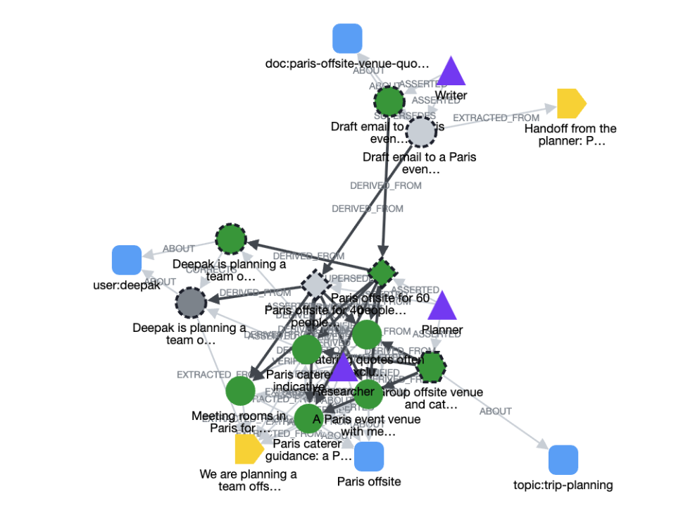

# Division Bell

**Graph memory for AI agents with lineage and blast radius.**

When a fact is retracted, the bell rings for everything built on it.

Built for [Graph Hacks: Context for AI Agents](https://www.wemakedevs.org/hackathons/falkordb) (WeMakeDevs x FalkorDB).
**Track 02: Agent Memory and Coordination.** FalkorDB is the only database.

Demo video: https://www.youtube.com/watch?v=hmsadb11ja0

## The problem

Agents that share a memory also share each other's mistakes. One agent records a wrong fact, other agents
build decisions and drafts on it across sessions and handoffs, and nothing tracks what depended on what.
Vector memory finds items that sound similar to the wrong fact. It cannot answer "what was built on this fact?",
and similarity is a poor stand-in for dependency (see [Evaluation](#evaluation)).

## What it does

- **Lineage.** Every fact, decision, draft and procedure records the items it was derived from, as `DERIVED_FROM` edges in FalkorDB.
- **Blast radius.** `retract(fact)` finds everything downstream with one variable-length Cypher traversal, flags it, and tells the agents that own it. `blast_radius` is the same traversal as a dry run.
- **Explain.** `explain(item)` returns the chain of facts and agents behind any item.
- **Changed versus wrong.** A fact that was true and then changed is superseded (history is kept, dependents are flagged "changed" for review). A fact that was wrong is retracted or corrected (dependents are flagged "wrong" and must be redone).
- **Three layers of memory.** Private by default, shared only when an agent publishes, and one separate graph per organisation.
- **Per-fact trust.** Each fact has a standing (verified, the user's word, unverified, doubtful) based on evidence checks, with the author's accuracy as a fallback.
- **Automatic upkeep.** At the start of its next turn, each agent is told what needs attention: items flagged because a source was retracted or changed, and facts another user's evidence disputes.

## Quick start

You need Docker with Compose and your own Anthropic API key.

```
git clone https://github.com/vagadro/division-bell
cd division-bell
docker compose up --build -d
```

1. Open <http://localhost:8000>, enter a name and pick an organisation.
2. Paste your Anthropic API key into the box at the bottom left and click **Save**.
3. Chat. The three agents (Researcher, Planner, Writer) reply and the memory graph on the right fills in as they save facts.

A message costs about half a cent with Claude Haiku 5.5. Spend is capped at $1 per key per server run.

Things to try, in your own words:

- Tell the Researcher about yourself or your work, then start a new chat and ask it what it remembers.
- Ask a factual question about a company. The Researcher checks memory first, searches the web only if memory has no answer, and saves what it finds with its sources.
- Click a node in the graph, then **Explain** (the chain behind it) or **Blast radius** (everything built on it).
- Tell the agent that a saved fact is wrong, and watch what gets flagged.
- Use **Switch user** to enter the same organisation under a second name. That user sees the first user's shared facts but never the private ones, and cannot change them.

To stop the stack, run `docker compose down`. Your data stays in a volume. `docker compose down -v` deletes it.
The FalkorDB Browser is at <http://localhost:3000>. Sign in with host `localhost`, port `6379`, username `graphhacks` and password `local-demo-password`, or with your own `FALKORDB_USERNAME` and `FALKORDB_PASSWORD` if you set them in a `.env` file. If you choose your own, keep the username to letters and digits: a character such as `@` works for the app but breaks the Browser's sign-in.

The app and the database are started by Docker on your own machine, and the memory is stored only there. The one thing that leaves it is what the agents send to the Anthropic API with your key to get their answers, including the web searches Anthropic runs for them. The default credentials only protect that empty local database. The Browser shows the raw graph, including every user's data and the chat messages, while the page shows only what one user's agents may see.

An `ANTHROPIC_API_KEY` in a `.env` file next to `docker-compose.yml` works as a fallback for requests that send no key. Use it only on your own machine (see [Security notes](#security-notes)).

## How it works

```
  Browser (frontend/)
        |  HTTP, one request per message
        v
  FastAPI server (backend/server.py)
        |  runs the user's three agents on Claude Haiku 5.5 with tool use
        v
  Memory layer (backend/memory.py), Cypher in backend/queries.py
        |
        v
  FalkorDB: one graph per organisation
```

- **Agents.** Each user gets three agents on first visit: Researcher, Planner and Writer. The Researcher answers first and hands work on when needed. A handoff starts the teammate at once (up to three hops, same user only).
- **Memory tools.** The agents call `remember`, `recall`, `decide`, `supersede`, `correct`, `retract`, `confirm`, `publish`, `handoff`, `inbox`, `explain`, `blast_radius`, `flagged`, `learn_procedure`, `recall_procedures`, `search_history`, `check_fact`, `verify_fact`, `save_web_fact` and `read_document`. They are written once in `backend/tools.py` and used by the chat agents and by the optional MCP server (`backend/mcp_server.py`).
- **Read-only page.** The page can only look: Explain and Blast radius. Changes to memory are made by the agents from the chat, as they would be in an organisation.
- **Ownership.** An agent belongs to a user. A user's agents share that user's private memory and may change each other's facts. Agents of other users can read shared facts but cannot change them, so one user's memory never changes because of another user's edit. They write their own competing facts instead.
- **Layers.** Private (visible to the owning user's agents) goes to shared (an explicit `publish`, allowed only when everything the item was built on is already shared). One graph per organisation is the wall nothing crosses.
- **Rules live in the memory layer.** Sources must be active and visible to the agent, a decision can only be built on items the agent may see, nothing can be built on a retracted, flagged or superseded item, and `retract` is one atomic query so a concurrent write cannot slip past it.

## Graph data model

One graph per organisation, so there is no tenant node. Every node has a stable string `id` such as `fact:1` or `agent:sam-researcher`.



*The page's graph panel after one chat. Circles are facts, the diamond is a decision, the hexagon a procedure, triangles are agents, and the rounded squares are entities. Green is active, grey is retracted or superseded, and a dashed border means private. The arrows labelled `DERIVED_FROM` are the lineage that blast radius follows.*

| Node | Main properties |
|---|---|
| `Agent` | `name`, `owner` (the user's id) |
| `Session` | a chat; it is the episode that holds the messages |
| `Message` | `role`, `text`, `seq`, `at`, `agent` |
| `Entity` | a thing several facts are about, such as `org:acme` |
| `Fact` | `text`, `visibility` (private or shared), `status` (active, superseded, retracted, flagged), `source` (user, web, document, agent), `confidence`, `valid_from`, `valid_to`, `recorded_at` |
| `Decision` | `text`, `status`, `visibility`, `created_at`, `recorded_at` |
| `Procedure` | `name`, `steps`, `visibility`, `status` (active, flagged, superseded, retired) |
| `Handoff` | a node, so "who received fact X?" is a real traversal |

| Edge | Meaning |
|---|---|
| `(Agent)-[:ASSERTED]->(Fact or Decision or Procedure)` | who wrote it |
| `(Agent)-[:RAN]->(Session)` | who ran the chat |
| `(Session)-[:HAS_MESSAGE]->(Message)` | conversation history |
| `(Fact)-[:ABOUT]->(Entity)` | what the fact is about |
| `(Fact or Decision or Procedure)-[:DERIVED_FROM]->(Fact or Decision)` | lineage: from the derived item to its source |
| `(Fact)-[:SUPERSEDES]->(Fact)` | the new fact points to the old one it was true before |
| `(Fact)-[:CORRECTS]->(Fact)` | the corrected fact points to the wrong one it replaces |
| `(Fact)-[:EXTRACTED_FROM]->(Message)` | evidence only; blast radius never follows it |
| `(Agent)-[:VERIFIED {method, result, sources, snippet, at}]->(Fact)` | an evidence check from the web or a document |
| `(Agent)-[:SENT]->(Handoff)-[:TO]->(Agent)`, `(Handoff)-[:CARRIED]->(item)` | handoffs |

`DERIVED_FROM` points from the derived item to its source. Blast radius walks it backward, provenance walks it forward.

**Supersede or retract.** Supersede means the fact was true and then changed: the old fact stays as history and dependents are flagged "changed", which their owners can confirm or redo. Retract means the fact was wrong: dependents are flagged "wrong" and must be redone, and the retraction counts against the author's accuracy (a reliability record, not a punishment).

**Standing.** A fact checked and supported by evidence is verified, whoever wrote it. A fact the user stated is the user's word and never counts for or against an agent. With no evidence, a fact is unverified, or doubtful if its author's accuracy is low or a check contradicted it. Accuracy is `(claims - mistakes + 4) / (claims + 4)`, counted from the graph.

## Key Cypher queries

All queries are in [`backend/queries.py`](backend/queries.py).

**Blast radius.** Everything built on an item, directly or through other items, that the caller may see, with its distance.

```cypher
MATCH (me:Agent {id:$me})
MATCH p = (s {id:$id})<-[:DERIVED_FROM*1..]-(x)
MATCH (a:Agent)-[:ASSERTED]->(x)
WHERE x.visibility IS NULL OR x.visibility = 'shared' OR a.id = me.id OR a.owner = me.owner
RETURN x.id AS id, x.text AS text, x.status AS status, a.id AS agent, min(length(p)) AS depth
ORDER BY depth, id
```

**Retract.** One atomic query: it marks the fact retracted, collects every active or flagged item downstream, and flags each one with the retraction that caused it. It returns no row, and changes nothing, unless the caller is allowed to change the fact.

```cypher
MATCH (f:Fact {id:$id}) WHERE f.status IN ['active', 'flagged']
MATCH (me:Agent {id:$by})
MATCH (asserter:Agent)-[:ASSERTED]->(f) WHERE asserter.id = me.id OR asserter.owner = me.owner
SET f.status = 'retracted', f.retracted_at = $now, f.retracted_by = $by,
    f.retract_reason = $reason
WITH f
OPTIONAL MATCH (f)<-[:DERIVED_FROM*1..]-(x) WHERE x.status IN ['active', 'flagged']
WITH f, collect(DISTINCT x) AS affected
FOREACH (n IN affected | SET n.status = 'flagged',
                             n.flagged_by = coalesce(n.flagged_by, []) + [f.id],
                             n.flag_wrong = coalesce(n.flag_wrong, []) + [f.id])
RETURN f.id AS id, [n IN affected | n.id] AS flagged
```

**Provenance (explain).** The chain behind an item, nearest first, with the agent who asserted each link. `*0..` includes the item itself.

```cypher
MATCH p = (x {id:$id})-[:DERIVED_FROM*0..]->(src)
MATCH (a:Agent)-[:ASSERTED]->(src)
RETURN src.id AS id, src.text AS text, a.id AS agent, length(p) AS depth, src.status AS status
ORDER BY depth
```

**Recall.** Current facts about an entity that the caller may see, with the ids they were built on and the latest evidence checks. Retracted, flagged and superseded facts are left out.

```cypher
MATCH (me:Agent {id:$me})
MATCH (author:Agent)-[:ASSERTED]->(f:Fact)-[:ABOUT]->(:Entity {id:$entity})
WHERE f.status = 'active' AND f.valid_to IS NULL
  AND (f.visibility = 'shared' OR author.id = me.id OR author.owner = me.owner)
OPTIONAL MATCH (f)-[:DERIVED_FROM*1..3]->(src)
OPTIONAL MATCH (:Agent)-[v:VERIFIED {result:'supported'}]->(f)
OPTIONAL MATCH (:Agent)-[x:VERIFIED {result:'contradicted'}]->(f)
RETURN f.id AS id, f.text AS text, collect(DISTINCT src.id) AS built_on, author.id AS author,
       coalesce(f.source, 'agent') AS source, max(v.at) AS supported_at, max(x.at) AS contradicted_at
```

## Track 02 coverage

| Brief | Where it is |
|---|---|
| Episodic memory, persistent conversation history | `Message` nodes in a `Session`; `search_history` uses a full-text index across a user's earlier chats |
| Semantic memory | `Fact` and `Entity` with validity times; `recall`, `recall(as_of=...)`, supersede and correct |
| Procedural memory | `Procedure` nodes: learn, revise, retire, recall; flagged and confirmed like facts |
| Shared state | explicit `publish`, with the rule that everything an item was built on must be shared first |
| Handoffs between agents | `Handoff` nodes, `inbox`, and automatic handoffs inside a chat turn |
| Separate memory per user | the `owner` rule: private by default, only the owner's agents may change an item |
| Separate memory per tenant | one FalkorDB graph per organisation (`Tenants` in `memory.py`) |
| High-concurrency reads and writes | each rule is enforced inside one atomic query; see the concurrency results below |

## Evaluation

The question: a fact turns out to be wrong. Which saved items were built on it?

The test set has 16 scenarios from 16 domains and 246 items (facts, decisions, drafts and procedures; 78 are decoys on the same topic that nothing relied on). It holds 98 such questions with 329 items that truly relied on a wrong fact. The wording of the items was written by a language model for hand-designed scenarios, and the answer key is the designed dependency structure. Every method answers every question against the same FalkorDB graph.

| Method | Precision | Recall | F1 |
|---|---|---|---|
| **Graph traversal (blast radius)** | 1.00 | 1.00 | **1.00** |
| LLM that reads all the notes (Claude Haiku 5.5, no links, mean of 3 runs) | 1.00 | 0.73 | 0.84 |
| Vector similarity, later items of the scenario | 0.53 | 0.72 | 0.61 |
| Keyword overlap, later items of the scenario | 0.48 | 0.85 | 0.61 |
| Graph, one hop only | 1.00 | 0.37 | 0.54 |
| Flag every later item in the scenario (the floor) | 0.31 | 1.00 | 0.48 |

Similarity cutoffs are chosen leave-one-scenario-out: each scenario is scored with the cutoff that is best on the other 15. Intervals from resampling scenarios, and per-scenario results, are in [`backend/eval/results/accuracy.md`](backend/eval/results/accuracy.md).

**What this shows.**

- On this test set, similarity search did not recover dependency. Tuned vector and keyword search are only about 0.13 F1 above flagging everything.
- The strongest alternative is an LLM that reads the notes. It needs no recorded links and is precise, but it missed 27% of the affected items, mostly indirect ones whose dependency is not written in the text, and its cost grows with the size of the memory.
- The traversal is exact on recorded links, including through chains of facts, decisions, drafts and procedures.

Any store that records parent links could answer this question. What FalkorDB adds here is that retract and blast radius are single traversals inside the database: the flagging happens in the same atomic query, and the ownership and visibility rules are enforced in the same place.

**What it does not show.** The graph answers from the links agents recorded, so its score on perfect links checks the traversal, not the agents. A simulation with assumed error rates (not measured on real agents) shows how much it depends on them:

| Links recorded badly | Rate | Precision | Recall | F1 |
|---|---|---|---|---|
| Some forgotten | 10% | 1.00 | 0.80 | 0.89 |
| Some forgotten | 25% | 1.00 | 0.64 | 0.78 |
| Extra wrong links added | 10% | 0.88 | 1.00 | 0.94 |
| Extra wrong links added | 25% | 0.79 | 1.00 | 0.88 |

At a 25% forgetting rate the graph falls below the LLM reader. Lineage wins when agents record what they built on, which is why every write tool takes `derived_from`.

**Do real agents record the links?** [`agent_links.py`](backend/eval/agent_links.py) runs 10 short, hand-written requests through the real Researcher, Planner and Writer (Claude Haiku 5.5): the user states three facts, then asks for a plan and a draft. In 9 of 10 the agents wrote a plan and a draft (in the tenth the Researcher asked for missing information first). Of the 42 dependencies visible in the text of those plans and drafts, all 42 had a recorded path back to the fact, and none of the 18 items was saved without a source. These were short, single-chat tasks with one model and one run, and the check only sees dependencies whose value is repeated in the text, so longer, multi-session work remains untested. Details in [`agent_links.md`](backend/eval/results/agent_links.md).

The graph flags every item downstream of a wrong fact, however far away, so read its flags as "review these", a safe superset, not "these are certainly wrong". With 16 scenarios the sample is small.

**Rules, concurrency and scale.** Two further scripts use templated scenarios, because only the graph's shape matters there.

- [`lifecycle.py`](backend/eval/lifecycle.py): 29 rules (supersede, retract, confirm, recall, correct, who may change what, sharing between users), 954 of 954 evaluations pass. Tenant isolation is covered by `backend/tests/test_tenancy.py`.
- [`scale.py`](backend/eval/scale.py): with 20 threads racing retracts against new writes, there were 0 active items built on a retracted fact in all 5 rounds. A blast radius takes 0.9 ms on 452 items and 16 ms on 46,500 items. Its cost grows with the whole graph, because the query plan starts from every agent's items instead of the one fact, and with the number of paths: a 20-layer tangle in which every item depends on two others takes 3.5 s. Real memories are far shallower.

To rerun, start FalkorDB (`docker compose up -d`) and create a `.env` file in the repository root with `FALKORDB_HOST=localhost`, `FALKORDB_PORT=6379`, `FALKORDB_USERNAME=graphhacks` and `FALKORDB_PASSWORD=local-demo-password`. Then:

```
uv venv --python 3.12
uv pip install -r backend/requirements-eval.txt
cd backend
uv run python eval/accuracy.py
```

The recorded answers of the LLM reader are cached in `backend/eval/data/reader_cache.json`, so this run needs no API key.

## Tests

```
cd backend
uv run pytest
```

227 tests, none of which call a model. They need FalkorDB running and the `.env` file above.

## Security notes

- **No login.** The memory layer does not authenticate callers. Anyone who types the same name in the same organisation is that user. This is demo-grade by design; a real deployment would put authentication in front.
- **Your API key.** It stays in the browser tab (`sessionStorage`) and is sent to the server in a header with each message. The server builds a client for that request only and never writes the key to disk, the database or the logs. Spend is counted per key, using a hash of it.
- **Do not host this publicly with a server-side key.** If `ANTHROPIC_API_KEY` is set on the server, anyone who can reach the page can chat on it. A public deployment must leave it unset, so each visitor pastes their own, and must be served over HTTPS because the key travels in a header.
- **Local only by default.** Docker publishes the app and the database on `127.0.0.1` only. The page loads Cytoscape 3.30.2 from the jsDelivr CDN.

## Repository layout

```
backend/
  memory.py       memory layer: the rules and the API over the Cypher
  queries.py      every Cypher query, with comments
  tools.py        the agent tools, written once
  llm.py          model calls, chat turns, evidence checkers
  server.py       HTTP API for the page
  mcp_server.py   the same tools as an MCP server (stdio)
  documents.py    text extraction for evidence checks
  tests/          227 tests
  eval/           accuracy, lifecycle and scale evaluations, data and results
frontend/         the page: index.html, style.css, app.js
Dockerfile, docker-compose.yml
```

## AI assistance

This project was built with AI assistance. The author used Claude Code (Anthropic) as a coding assistant to test code, documentation and reviewing it. The agents in the running app use Claude Haiku 5.5.

## Prior art

Lineage, provenance and cascading repair for agent memory are active research areas, and this project does not claim to be the first to apply them.

- [Graphiti and Zep](https://github.com/getzep/graphiti): a temporal knowledge graph for agent memory, with FalkorDB support.
- [Mem0](https://github.com/mem0ai/mem0) and [Letta](https://github.com/letta-ai/letta): agent memory systems.
- [MemTX: Transactional Belief Commit for Stateful Agent Memory](https://arxiv.org/abs/2607.23929): staged belief commits with cascading retraction through a derivation graph. The closest work to this one.
- [MemLineage: Lineage-Guided Enforcement for LLM Agent Memory](https://arxiv.org/abs/2605.14421): derivation lineage used as a security control.
- [Governed Shared Memory for Multi-Agent LLM Systems](https://arxiv.org/abs/2606.24535): scoped retrieval, supersession and provenance for fleets of agents.
- [MEMOREPAIR](https://arxiv.org/abs/2605.07242) and [Dependency-Guided Rollback Repair for Memory-Augmented Agents](https://arxiv.org/abs/2608.10502): repairing agent memory after faults.

What this project adds is a concrete implementation on FalkorDB, where retract and blast radius are single Cypher traversals, together with per-user ownership rules, per-fact standing from evidence, and a measured comparison of the graph against similarity search and against an LLM reading the notes.

## Limitations and future work

- Lineage follows only the links agents record. A dependency nobody wrote down is never flagged.
- Blast radius is the full downstream set, which is a safe superset of what is actually wrong.
- Only Claude models are supported. An adapter for other providers, and a remote MCP server (which needs OAuth), are future work.
- Real agents recorded every link on short tasks (see [Evaluation](#evaluation)). Measuring this on long, multi-session work is the next evaluation.

## About the name

The name is inspired by Pink Floyd's 1994 album *The Division Bell*, which is widely described as being about communication: how people talk, fail to connect and misunderstand each other. This project is about the same failure between agents, where one agent's mistake is passed on as the team's belief. The title is the bell that calls members of the UK Parliament in to vote. Here, the bell rings when a fact is retracted or changes: every agent that built on it is told at the start of its next turn.
